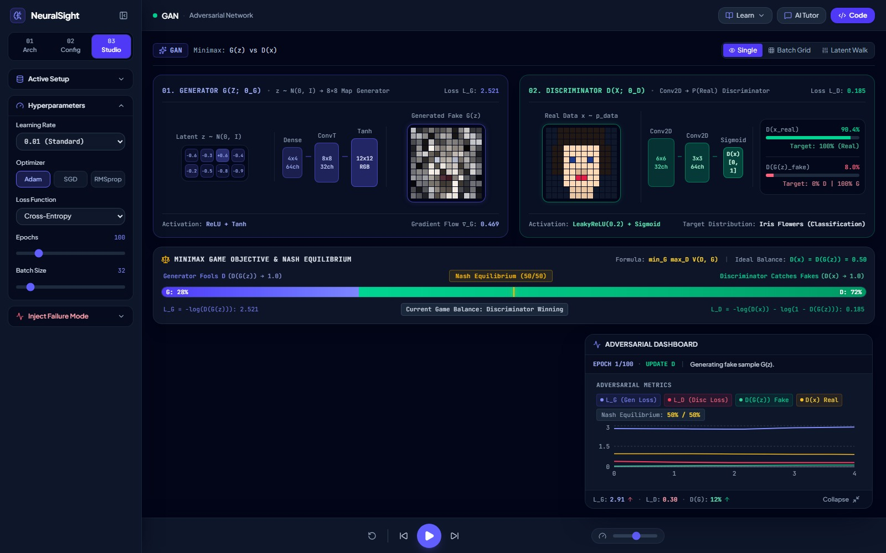
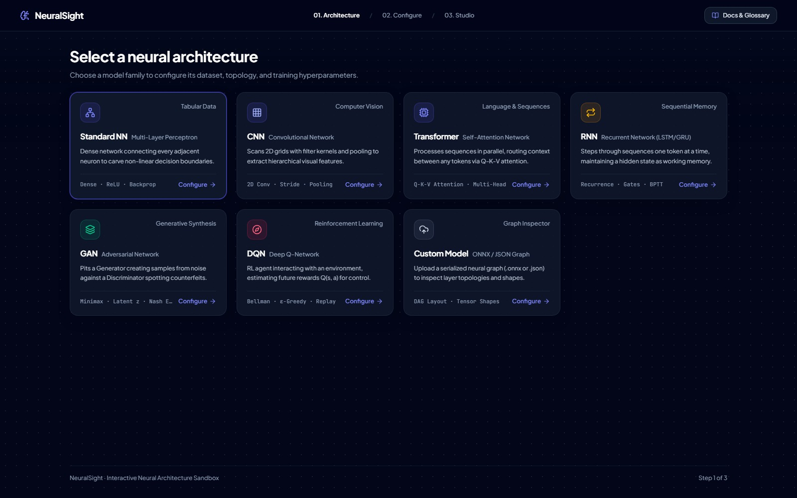
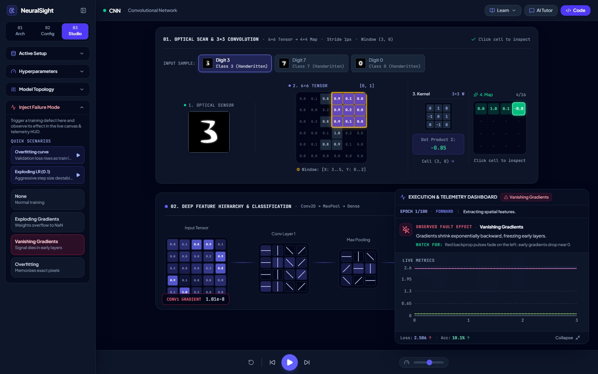
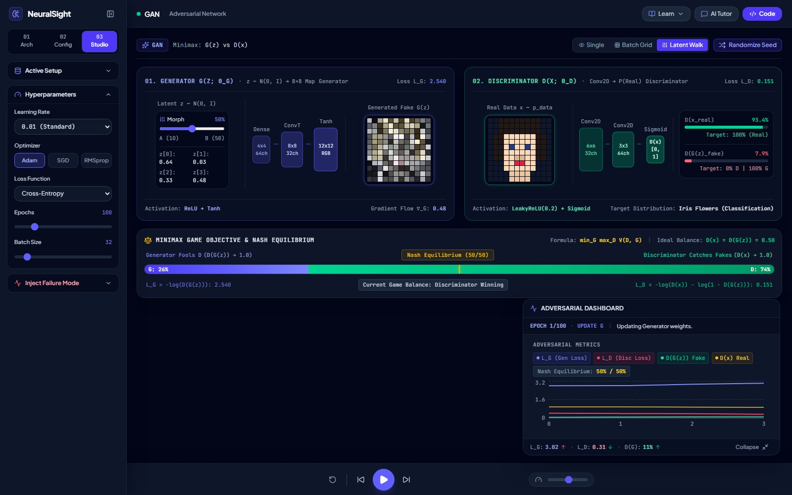

# NeuralSight — Interactive Deep Learning Architecture & Dynamics Visualizer

[](https://www.typescriptlang.org/)
[](https://react.dev/)
[](https://tailwindcss.com/)
[](https://expressjs.com/)
[](https://opensource.org/licenses/MIT)

An interactive, browser-native deep learning simulator and visual mental-model studio that makes neural network architectures, tensor flows, backpropagation gradients, adversarial game equilibria, and failure pathologies **tangible, interactive, and intuitive**—complete with a context-aware **Gemini AI Tutor** and **PyTorch / Keras** code export.

---

## Table of Contents

1. [What is NeuralSight?](#what-is-neuralsight)
2. [What It Is vs. What It Is Not](#what-it-is-vs-what-it-is-not)
3. [3-Stage Studio Workflow](#3-stage-studio-workflow)
4. [Supported Architectures](#supported-architectures)
5. [Studio Interface, Controls & Telemetry](#studio-interface-controls--telemetry)
6. [NeuralSight AI Tutor (Server-Side Gemini SSE)](#neuralsight-ai-tutor-server-side-gemini-sse)
7. [How to Read & Interpret Every Graphic](#how-to-read--interpret-every-graphic)
8. [Code Export (PyTorch & TensorFlow / Keras)](#code-export-pytorch--tensorflow--keras)
9. [Visual Tour](#visual-tour)
10. [Getting Started (Local Development)](#getting-started-local-development)
11. [Technology Stack](#technology-stack)

---

## What is NeuralSight?

**NeuralSight** bridges the gap between abstract deep learning equations and opaque framework calls like `loss.backward()`:

* **Interactive Architecture Microscopes:** Inspect forward activations, 2D sliding kernels, multi-head self-attention matrices, Q-value gridworlds, recurrent unrolling, and dense MLP graphs in real time.
* **Live Hyperparameter & Topology Tuning:** Adjust learning rates, optimizers, loss functions, layer depths, strides, attention heads, recurrent cell types, and RL discount factors while watching the canvas adapt immediately.
* **Failure Mode Preset Toggles:** Trigger textbook pathologies (Exploding/Vanishing Gradients, Overfitting, Mode Collapse, Discriminator Overpowering, Attention Collapse, Poor Exploration) via one-click auto-play preset toggles.
* **Embedded AI Tutor:** Ask any ML/DL/math question—or troubleshoot your active training curve—inside a streaming side drawer grounded in your live simulation state.

---

## What It Is vs. What It Is Not

| What It **IS** | What It **IS NOT** |
| :--- | :--- |
| ✅ **An interactive visual mental model** for building intuition on neural network dynamics. | ❌ **A distributed training cluster** for fitting multi-billion-parameter production models. |
| ✅ **A live step-by-step simulator** showing forward passes, loss behavior, and backpropagation flow. | ❌ **A static slideshow** of pre-recorded animations. |
| ✅ **A failure-mode diagnostic sandbox** for testing Mode Collapse, Vanishing/Exploding Gradients, and Overfitting. | ❌ **A replacement benchmark** for PyTorch, TensorFlow, or TensorRT runtime profiling. |
| ✅ **A guided learning environment** combining visual canvases, KaTeX math docs, spotlight tours, and an AI Tutor. | ❌ **A pure toy UI**—visualizations reflect authentic mathematical properties and tensor shapes. |

---

## 3-Stage Studio Workflow

NeuralSight guides learners through a structured three-stage progression (accessible anytime from the sidebar stage indicator):

1. **`01. Arch` — Architecture Selection Hub:**
   Browse 7 neural network paradigms (`Standard NN`, `CNN`, `Transformer`, `RNN`, `GAN`, `DQN`, and `Custom Model`) with domain tags, core mechanisms, and quick access to the **Glossary**.
2. **`02. Config` — Task, Dataset & Hyperparameter Setup:**
   Choose **Train** or **Inference** mode, pick a task objective and dataset/environment (with an interactive **Dataset Preview** inspector), configure starting hyperparameters, or drop an `.onnx` / `.json` graph for **Custom Model** inspection.
3. **`03. Studio` — Interactive Simulation Studio:**
   Experiment on the live dot-grid canvas with the collapsible left tuning sidebar, top **Learn** menu (`Docs, TLDR & Glossary`, `Canvas Spotlight Tour`, `Quick-Start Guide`), **AI Tutor** drawer, **Code** export modal, bottom **Execution & Telemetry Dashboard (`MetricsHUD`)**, and micro-step playback controls.

---

## Supported Architectures

### 1. Generative Adversarial Networks (GAN)
* **Mathematical Core:** $\min_G \max_D V(D, G) = \mathbb{E}_{x \sim p_{\text{data}}}[\log D(x)] + \mathbb{E}_{z \sim p_z}[\log(1 - D(G(z)))]$
* **Visual Components:**
  * **Latent Noise Vector ($z$):** Interactive Gaussian latent vector with Inference-mode latent morphing.
  * **Generator $G(z)$ & Discriminator $D(x)$:** Progressive upsampling vs. strided discrimination pipeline.
  * **Adversarial Tug-of-War Balance Bar:** Live tracker around the 50/50 Nash Equilibrium ($D(x) \approx D(G(z)) \approx 0.50$).
  * **Batch Diversity Grid:** 2×2 multi-seed sample grid revealing healthy diversity vs. Mode Collapse.

### 2. Convolutional Neural Networks (CNN)
* **Mathematical Core:** $(I * K)(i, j) = \sum_m \sum_n I(i-m, j-n) K(m, n)$
* **Visual Components:**
  * **Optical Input Sensor:** Pixel grid across MNIST Digits, CIFAR-10 Objects, or Chest X-Rays.
  * **Sliding Kernel & Feature Maps:** Configurable Conv Depth (`1–3` layers), Stride (`1–3 px`), and Pooling (`Max` or `Average`).
  * **Classification Output:** Flattened feature activations feeding class probability outputs.

### 3. Transformer (Multi-Head Self-Attention)
* **Mathematical Core:** $\text{Attention}(Q, K, V) = \text{softmax}\left(\frac{QK^T}{\sqrt{d_k}}\right)V$
* **Visual Components:**
  * **Token Embeddings & Positional Encodings:** Sequence inputs across translation, sentiment, market candles, and more.
  * **Multi-Head Switcher (`1`, `2`, or `4` Heads):** Inspect distinct syntactic, positional, or semantic attention subspaces.
  * **Attention Matrix & Beams:** Interactive $N \times N$ heatmap and connecting weight beams.

### 4. Deep Q-Networks (DQN / Reinforcement Learning)
* **Mathematical Core:** $Q(s, a) \leftarrow Q(s, a) + \alpha \big[r + \gamma \max_{a'} Q(s', a') - Q(s, a)\big]$
* **Visual Components:**
  * **Interactive Gridworld:** Live agent navigation with obstacles, penalties, and goal rewards.
  * **Q-Value Action Heads & Policy Arrows:** Live **Up / Down / Left / Right** action valuations and greedy policy arrows.
  * **RL Knobs:** Toggle **Exploration Schedule** (`Fast (Greedy)`, `Standard`, `High Exploration`) and **Discount Factor ($\gamma$)** (`0.50`, `0.90`, `0.99`).

### 5. Recurrent Neural Networks (RNN / LSTM / GRU)
* **Mathematical Core:** $h_t = \tanh(W_{hh} h_{t-1} + W_{xh} x_t + b_h)$
* **Visual Components:**
  * **Unrolled Temporal Timeline:** Configurable unroll horizon (`3`, `5`, or `8` steps).
  * **Cell Type Selector:** Switch between `Vanilla RNN`, `LSTM`, and `GRU` to observe gating vs. gradient decay across early time steps.

### 6. Standard Neural Networks (MLP)
* **Mathematical Core:** $a^{(l)} = \sigma\big(W^{(l)} a^{(l-1)} + b^{(l)}\big)$
* **Visual Components:**
  * **Configurable Dense Topology:** Adjust **Hidden Layers** (`1–3`) and **Neurons / Layer** (`4`, `8`, `16`).
  * **Synaptic Weight Graph & Activations:** Live forward signals, weight polarity, and gradient flow.

### 7. Custom Model Architect
* **Graph Inspector:** Upload `.onnx` (parsed client-side via `onnx-proto`) or `.json` model definitions to render interactive DAG node graphs with **React Flow** and **Dagre** auto-layout.

---

## Studio Interface, Controls & Telemetry

### Top Studio Header
* **Sidebar Toggle & Active Model Indicator:** Collapse/expand the left configuration drawer and view the active architecture title.
* **`Learn` Dropdown:**
  * **Docs, TLDR & Glossary:** Architecture-specific mathematical guides and an interactive ML/DL concept dictionary.
  * **Canvas Spotlight Tour:** Guided step-by-step highlight overlay walking through key panels on the active canvas.
  * **Quick-Start Guide:** Reopen the introductory onboarding tour anytime.
* **`AI Tutor` Button:** Opens the slide-over NeuralSight AI Tutor drawer (maintains a separate conversation thread per architecture).
* **`Code` Button:** Opens the native **PyTorch** and **TensorFlow / Keras** script generator.

### Left Inspector Sidebar
1. **Stage Stepper & Mode Toggle:** Jump back to `01. Arch` or `02. Config`, or switch between **Train** and **Inference** modes.
2. **Active Setup:** Displays the current Task Objective and Dataset/Environment, with **Preview** and **Edit setup** buttons.
3. **Hyperparameters:**
   * **Learning Rate:** `0.1`, `0.01`, `0.001`, `0.0001`
   * **Optimizer:** `Adam`, `SGD`, `RMSprop`
   * **Loss Function:** `Cross-Entropy`, `MSE`, `Huber`
   * **Epochs / Episodes (`10–500`)** & **Batch Size (`8–256`)**
4. **Model Topology (Dynamic per Architecture):** Adjusts structural knobs specific to the active model (ignored for GAN and Custom Model).
5. **Inject Failure Mode:** Architecture-specific one-click preset toggles (e.g., *Overfitting curve*, *Vanishing gradients*, *Exploding LR (0.1)*, *Mode collapse*, *Attention collapse*, or healthy comparison baselines) that apply a curated hyperparameter patch, reset to step `0`, and auto-play immediately—click an active fault preset again (or **Clear**) to return to normal training.

### Execution & Telemetry Dashboard (`MetricsHUD`) & Playback
* **Collapsed Telemetry Bar:** Floating summary bar above the playback dock showing live Epoch/Phase status, active failure warning icon, latest metrics (`Loss` / `Acc` or GAN `L_G` / `L_D` / `D(G)`) with **green/rose directional trend arrows**, and an **Expand** button.
* **Expanded Dashboard:** Reveals dual **Recharts** trend charts (Loss & Validation Loss vs. Accuracy / Adversarial Scores), overfitting/memorization alert banners, and a bottom **Collapse** bar positioned right above the playback controls.
* **Playback Controls:** Play/Pause, Step Backward, Step Forward, Reset, and simulation speed (`0.25×` to `4×`).

---

## NeuralSight AI Tutor (Server-Side Gemini SSE)

The AI Tutor is backed by an Express endpoint (`POST /api/chat` in `server.ts`) using the `@google/genai` SDK and Server-Sent Events (SSE) for real-time token streaming and KaTeX math rendering:

* **Complexity & Context-Aware Model Routing:** Scores query complexity, follow-up depth, and live simulation health across 4 tiers (`fast`, `balanced`, `analytical`, `deep`) to automatically pick between `gemini-3.1-flash-lite` (`MINIMAL`–`HIGH`) and `gemini-4-hydrogen` (`LOW`–`HIGH`).
* **Context Compaction & Prefix Caching:** Places static tutor instructions in a stable prefix for implicit Gemini prefix caching and compacts older turns into a digest once threads grow long.
* **Stateless Payload-Hash Cache & Cooldown Failover:** Caches only genuinely stateless conceptual prompts (`history.length === 0` and no live-run deixis, with telemetry stripped from the prompt) keyed by `sha256(PROMPT_VERSION | model | thinkingLevel | systemInstruction | message)`. Supports `POST /api/chat/cache/purge` with hit/miss/bypass counters, and places overloaded models (`429`/`503`) into a 45-second cooldown while failing over seamlessly with full conversation context.
* **Offline Router Evaluation:** Benchmark routing accuracy, confusion matrix, stateless gating, and cache determinism against 150 labelled prompts via `npm run eval:router` (`scripts/eval-router.ts`).

---

## How to Read & Interpret Every Graphic

* **GAN Equilibrium:** Healthy training oscillates near $D(x) \approx 0.50$ and $D(G(z)) \approx 0.50$, with $L_G$ and $L_D$ hovering near $\ln 2 \approx 0.693$. In **Mode Collapse**, the 2×2 batch grid repeats nearly identical outputs.
* **CNN Feature Hierarchy:** Watch low-level edge detectors in early conv layers combine into higher-level shapes before spatial pooling downsamples the maps.
* **Transformer Attention:** Each row of the attention matrix sums to `1.0` via Softmax; brighter cells highlight stronger token-to-token context routing. In **Attention Collapse**, weights flatten into a uniform `1/N` blur.
* **Metrics Trend Arrows & Overfitting Alerts:** Green/rose directional arrows indicate step-over-step improvement vs. degradation. When Validation Loss diverges sharply from Training Loss, the HUD flags memorization.

---

## Code Export (PyTorch & TensorFlow / Keras)

Click **`Code`** in the Studio header to generate runnable Python training scripts reflecting your current architecture and hyperparameters:

* **PyTorch:** `torch.nn.Module` definition, loss criterion, optimizer (`Adam`, `SGD`, `RMSprop`), and training loop.
* **TensorFlow / Keras:** `tf.keras` model setup compiled with matching optimizer, loss, and training parameters.
* Copy directly to clipboard or download as `neuralsight_<architecture>.py`.

---

## Visual Tour

### Generative Adversarial Network (GAN) Visualizer


### Multi-Architecture Deep Learning Suite


### Hyperparameters, Diagnostics & Playback Engine


### Inference Mode, Latent Manifold Morphing & Diversity Inspection


---

## Getting Started (Local Development)

### Prerequisites
* **Node.js:** v18.0.0 or higher
* **npm:** v9.0.0 or higher
* **Gemini API Key** *(optional for visualizations, required for the AI Tutor)*

### Installation & Commands

1. **Install dependencies:**
   ```bash
   npm install
   ```

2. **Configure environment variables:**
   Copy `.env.example` to `.env` and set your key:
   ```bash
   GEMINI_API_KEY="your-gemini-api-key"
   ```

3. **Start the full-stack development server (Express + Vite middleware on port 3000):**
   ```bash
   npm run dev
   ```
   Open `http://localhost:3000` in your browser.

4. **Evaluate the AI Tutor router (offline, zero API calls):**
   ```bash
   npm run eval:router
   ```

5. **Type-check and build for production:**
   ```bash
   npm run lint
   npm run build
   ```

6. **Run the production server:**
   ```bash
   npm run start
   ```

---

## Technology Stack

* **Frontend:** [React 19](https://react.dev/) + [TypeScript](https://www.typescriptlang.org/) + [Vite 6](https://vitejs.dev/)
* **Backend & Streaming:** [Express 5](https://expressjs.com/) + [tsx](https://tsx.is/) + [`@google/genai`](https://www.npmjs.com/package/@google/genai)
* **Styling & UI Primitives:** [Tailwind CSS v4](https://tailwindcss.com/) + [Radix UI](https://www.radix-ui.com/) + [Lucide React](https://lucide.dev/) + [Motion](https://motion.dev/)
* **Visualization & Math:** [Recharts](https://recharts.org/) + [React Flow](https://reactflow.dev/) + [Dagre](https://github.com/dagrejs/dagre) + [KaTeX](https://katex.org/) + [`onnx-proto`](https://www.npmjs.com/package/onnx-proto)

---

## License

This project is licensed under the [MIT License](LICENSE). Contributions, issues, and feature requests are welcome!
